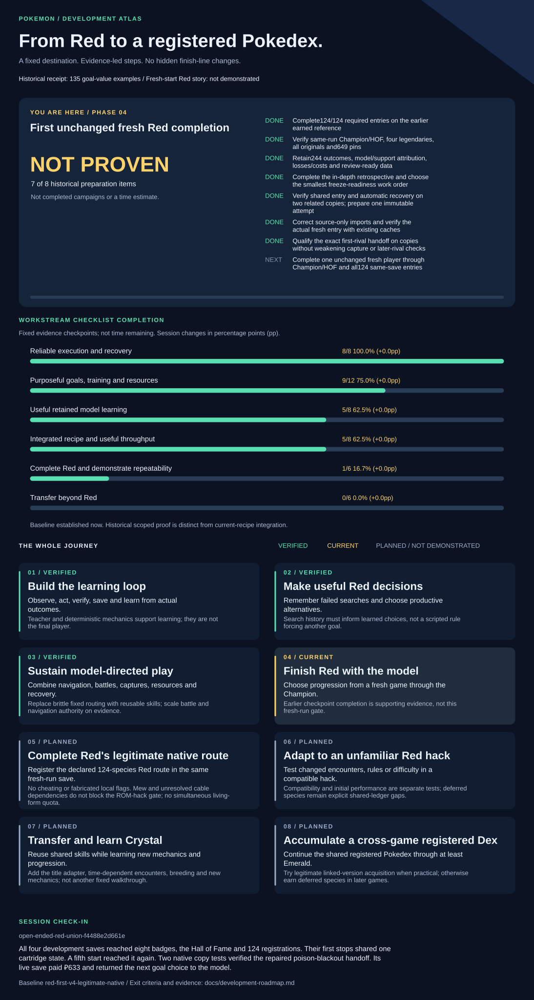

<!-- Generated by scripts/development_roadmap.py; edit the baseline/state, not this file. -->
# Development roadmap

Baseline: **red-first-v4-legitimate-native**. Reviewed through **open-ended-red-union-f4488e2d661e**.

A learned player must complete a fresh-start, model-directed Red run and Red's declared 124-species legitimate native route before any ROM hack, then continue one shared registered Pokedex through later titles to at least Emerald.

## Delivery status

**First unchanged fresh Red completion: not yet proved.**
Use the [six workstreams and milestone ladder](model-first-roadmap.md) for the active delivery plan.

Historical preparation receipts: 7 of 8 items

These earlier component/reference receipts are not a full-run success rate or a project percentage.

- [x] Complete124/124 required entries on the earlier earned reference ([evidence](../docs/evidence/red-same-save-run-completion-2026-10-10.json))
- [x] Verify same-run Champion/HOF, four legendaries, all originals and649 pins ([evidence](../docs/evidence/red-same-save-run-completion-2026-10-10.json))
- [x] Retain244 outcomes, model/support attribution, losses/costs and review-ready data ([evidence](../docs/evidence/red-same-save-run-completion-2026-10-10.json))
- [x] Complete the in-depth retrospective and choose the smallest freeze-readiness work order ([evidence](../docs/evidence/red-completed-run-data-assessment-2026-10-11.json))
- [x] Verify shared entry and automatic recovery on two related copies; prepare one immutable attempt ([evidence](../docs/evidence/red-fresh-player-continuity-2026-10-11.json))
- [x] Correct source-only imports and verify the actual fresh entry with existing caches ([evidence](../docs/evidence/red-source-only-frozen-launch-2026-10-11.json))
- [x] Qualify the exact first-rival handoff on copies without weakening capture or later-rival checks ([evidence](../docs/evidence/red-early-route22-handoff-2026-10-11.json))
- [ ] Complete one unchanged fresh player through Champion/HOF and all124 same-save entries

Pinned historical learning receipt: **135 examples**. The current model and integration boundary are reported below in the latest review and active state; this older chart receipt is not full-game competence.

## Workstream completion and session change

Percentages measure verified checkpoints in the fixed **workstream-checklist-v1** rubric.
They are a coarse capability assessment, not a fraction of remaining hours, a success probability,
or an overall project percentage. Some checked capabilities are historical scoped proofs;
the unchecked integration and fresh-run criteria require the current exact recipe.

Baseline starts with this tracking history; no earlier session gains are invented.
**pp** means percentage points: 40% to45% is +5pp. Regressions may reduce a score.

| Workstream | Verified checkpoints | Completion | This session |
| --- | ---: | ---: | ---: |
| Reliable execution and recovery | 8/8 | 100.0% | +0.0pp |
| Purposeful goals, training and resources | 9/12 | 75.0% | +0.0pp |
| Useful retained model learning | 5/8 | 62.5% | +0.0pp |
| Integrated recipe and useful throughput | 5/8 | 62.5% | +0.0pp |
| Complete Red and demonstrate repeatability | 1/6 | 16.7% | +0.0pp |
| Transfer beyond Red | 0/6 | 0.0% | +0.0pp |

### Evidence checklist

Equal checkpoint weights are a reporting convention; they do not imply equal difficulty.
Adding or changing checkpoints requires a new rubric version and explicit rebaseline,
reported separately from earned progress. Tracking/documentation alone earns no checkpoint.

#### Reliable execution and recovery

- [x] Scoped semantic observation, model choice, execution and referee loop demonstrated ([evidence](../docs/evidence/red-saved-endpoint-learning-result-2026-09-06.json))
- [x] Scoped battle and PP/control settlement repair demonstrated ([evidence](../docs/evidence/league-whole-battle-repair-2026-11-13.json))
- [x] Scoped walking/Fly loop repair demonstrated ([evidence](../docs/evidence/codex-route-rival-2026-11-11.json))
- [x] Scoped capture, storage and evolution continuations demonstrated ([evidence](../docs/evidence/funded-history-qualification-2026-11-14.json))
- [x] Interrupted composite outcome and paired-history retention demonstrated ([evidence](../docs/evidence/battle-pp-readiness-2026-11-16.json))
- [x] Current proposed release qualifies fresh start with target124 binding ([evidence](../docs/evidence/battle-pp-readiness-2026-11-16.json))
- [x] Same current recipe completes cash8 earning, preparation, supply and registration chain ([evidence](../docs/evidence/battle-pp-readiness-2026-11-16.json))
- [x] Current recipe completes varied linked story/collection tasks without operator repair ([evidence](../docs/evidence/train-preparation-choice-2026-11-17.json))

#### Purposeful goals, training and resources

Goal continuity: **2/4 (50.0%)**.

Training and party: **4/4 (100.0%)**.

Resources: **3/4 (75.0%)**.

- [x] Persistent commitment mechanism demonstrated across chunks ([evidence](../docs/evidence/codex-commitment-handoff-2026-11-11.json))
- [x] Narrow recurrence mechanism preserves normal greedy behavior in scoped checks ([evidence](../docs/evidence/stable-selection-2026-11-12.json))
- [ ] Matched native whole-midgame comparison improves progress and paid abandonment
- [ ] Goal improvement retains competence across varied origins
- [x] Target/helper XP, roster return and full-task accounting demonstrated ([evidence](../docs/evidence/training-goal-repair-2026-11-07.json))
- [x] Completed venue comparisons cover multiple trainees and timings ([evidence](../docs/evidence/venue-multitiming-train-2026-11-13.json))
- [x] Preparation/attempt/stop comparison demonstrates useful readiness at lower full cost ([evidence](../docs/evidence/production-preparation-2026-11-15.json))
- [x] Retained candidate improves native whole-task venue/trainee choices ([evidence](../docs/evidence/f125-normal-runner-2026-11-15.json))
- [x] Ordinary earned-income continuation demonstrated on diagnostic ancestry ([evidence](../docs/evidence/funded-history-qualification-2026-11-14.json))
- [x] Funded normal ball purchase and new registration demonstrated ([evidence](../docs/evidence/funded-history-qualification-2026-11-14.json))
- [ ] Held-out scarcity comparison supports useful spending quantities and reserves
- [x] Chosen recipe completes the full cash8 scarcity-to-registration chain ([evidence](../docs/evidence/battle-pp-readiness-2026-11-16.json))

#### Useful retained model learning

- [x] Collect, fit and productive continuation demonstrated with scoped provenance ([evidence](../docs/evidence/red-incremental-learning-completion-2026-09-07.json))
- [x] Real complete TRAIN task comparisons available ([evidence](../docs/evidence/venue-multitiming-train-2026-11-13.json))
- [x] Retention-aware candidate fit and native baseline comparison performed ([evidence](../docs/evidence/campaign-joint-rehearsal-2026-11-13.json))
- [x] Prospective eligibility, origin and censored-cost accounting demonstrated ([evidence](../docs/evidence/two-lane-litmus-closeout-2026-11-14.json))
- [ ] Next named consequential contrast yields useful held-out native improvement
- [ ] That useful candidate retains prior justified competence
- [x] Useful candidate integrated into the normal runner with matched task contract ([evidence](../docs/evidence/preparation-history-2026-11-16.json))
- [ ] Adopted improvement verified across varied independent eligible origins

#### Integrated recipe and useful throughput

- [x] Same-save multi-goal development play demonstrated with failures retained ([evidence](../docs/evidence/two-lane-litmus-closeout-2026-11-14.json))
- [x] Historical phase-level observation/execution cost measured ([evidence](../docs/evidence/menu-performance-2026-11-04.json))
- [x] Bounded configured-player concurrency and host-memory limits measured ([evidence](../docs/evidence/training-population-capacity-2026-11-08.json))
- [ ] Current exact full124 recipe passes relevant cross-boundary qualifications
- [x] Current dominant observation cost reduced with menu/quote/guard parity and measured gain ([evidence](../docs/evidence/red-late-collection-comparison-2026-11-18.json))
- [ ] Current workload sustains bounded memory/log growth at useful throughput
- [x] Current coherent whole-objective frozen comparison meets declared benefit and cost ([evidence](../docs/evidence/preparation-history-2026-11-16.json))
- [ ] Current campaign runtime/resource budget supported by useful integrated outcomes

#### Complete Red and demonstrate repeatability

- [x] Assisted same-save full-route completion establishes mechanical coverage ([evidence](../docs/evidence/red-same-save-run-completion-2026-10-10.json))
- [ ] Fresh DEVELOPMENT Champion/HOF+124 rehearsal finishes with at most three technical stops
- [ ] Current frozen fresh run reaches Champion/HOF without operator fixes or restores
- [ ] That same unchanged fresh run retains all124 declared native registrations
- [ ] Independent terminal/provenance verification accepts that exact full run
- [ ] Prospectively declared held-out clean starts achieve at least8of10 full successes

#### Transfer beyond Red

- [ ] Compatible unfamiliar hack and no-Red-experience control prospectively compared
- [ ] Red experience reduces teaching for useful native hack adaptation
- [ ] Shared Crystal adapter qualifies native observation/action/outcome contracts
- [ ] Learned shared player completes the declared Crystal story/task contract
- [ ] Shared player demonstrates declared native Emerald story/adaptation contract
- [ ] Legitimate deferred acquisition and cross-generation coverage verified

### Recent session percentage-point history

The latest ten sessions are shown here. The [complete existing history](../configs/development-roadmap-state.json) retains every before/after snapshot.

| Session | execution | choices | learning | integration | delivery | transfer |
| --- | ---: | ---: | ---: | ---: | ---: | ---: |
| completion-recovery-splits-20261117-1745 | 100.0%→100.0% (+0.0pp) | 75.0%→75.0% (+0.0pp) | 62.5%→62.5% (+0.0pp) | 50.0%→50.0% (+0.0pp) | 16.7%→16.7% (+0.0pp) | 0.0%→0.0% (+0.0pp) |
| fresh124-late-campaign-prep-20261117-2005 | 100.0%→100.0% (+0.0pp) | 75.0%→75.0% (+0.0pp) | 62.5%→62.5% (+0.0pp) | 50.0%→50.0% (+0.0pp) | 16.7%→16.7% (+0.0pp) | 0.0%→0.0% (+0.0pp) |
| same-seed-four-campaigns-20261117 | 100.0%→100.0% (+0.0pp) | 75.0%→75.0% (+0.0pp) | 62.5%→62.5% (+0.0pp) | 50.0%→50.0% (+0.0pp) | 16.7%→16.7% (+0.0pp) | 0.0%→0.0% (+0.0pp) |
| same-seed-league-evolution-monitoring-20261117 | 100.0%→100.0% (+0.0pp) | 75.0%→75.0% (+0.0pp) | 62.5%→62.5% (+0.0pp) | 50.0%→50.0% (+0.0pp) | 16.7%→16.7% (+0.0pp) | 0.0%→0.0% (+0.0pp) |
| completion-repairs-20261118-024218 | 100.0%→100.0% (+0.0pp) | 75.0%→75.0% (+0.0pp) | 62.5%→62.5% (+0.0pp) | 50.0%→50.0% (+0.0pp) | 16.7%→16.7% (+0.0pp) | 0.0%→0.0% (+0.0pp) |
| open-ended-red-20261118-033528 | 100.0%→100.0% (+0.0pp) | 75.0%→75.0% (+0.0pp) | 62.5%→62.5% (+0.0pp) | 50.0%→50.0% (+0.0pp) | 16.7%→16.7% (+0.0pp) | 0.0%→0.0% (+0.0pp) |
| late-collection-comparison-20261118-1417 | 100.0%→100.0% (+0.0pp) | 75.0%→75.0% (+0.0pp) | 62.5%→62.5% (+0.0pp) | 50.0%→62.5% (+12.5pp) | 16.7%→16.7% (+0.0pp) | 0.0%→0.0% (+0.0pp) |
| late-collection-transfer-20261118-1741 | 100.0%→100.0% (+0.0pp) | 75.0%→75.0% (+0.0pp) | 62.5%→62.5% (+0.0pp) | 62.5%→62.5% (+0.0pp) | 16.7%→16.7% (+0.0pp) | 0.0%→0.0% (+0.0pp) |
| four-run-repair-union-20261119-1437 | 100.0%→100.0% (+0.0pp) | 75.0%→75.0% (+0.0pp) | 62.5%→62.5% (+0.0pp) | 62.5%→62.5% (+0.0pp) | 16.7%→16.7% (+0.0pp) | 0.0%→0.0% (+0.0pp) |
| open-ended-red-union-f4488e2d661e | 100.0%→100.0% (+0.0pp) | 75.0%→75.0% (+0.0pp) | 62.5%→62.5% (+0.0pp) | 62.5%→62.5% (+0.0pp) | 16.7%→16.7% (+0.0pp) | 0.0%→0.0% (+0.0pp) |

Dated, in-progress interview checkpoint. The full-run delivery gate remains open. All six workstream percentages changed by zero points.

## Stable goals and exit criteria

| Stage and status | Goal | Exit criterion | Scope and evidence |
| --- | --- | --- | --- |
| 01. Build the learning loop — verified | Observe, act, verify, save and learn from actual outcomes. | Authenticated saved-state collection, retained-data fitting and a bounded post-fit continuation. | Teacher and deterministic mechanics support learning; they are not the final player. [Evidence](../docs/evidence/red-saved-endpoint-learning-result-2026-09-06.json) |
| 02. Make useful Red decisions — verified | Remember failed searches and choose productive alternatives. | A history-aware learner chooses between useful executable goals, learns from the result and continues productively. | Search history must inform learned choices, not a scripted rule forcing another goal. [Evidence](../docs/evidence/red-complete-evolution-learning-2026-09-07.json) |
| 03. Sustain model-directed play — verified | Combine navigation, battles, captures, resources and recovery. | Repeated multi-goal progress across varied Red situations, with measured costs, interventions and recovery. | Replace brittle fixed routing with reusable skills; scale battle and navigation authority on evidence. [Evidence](../docs/evidence/red-phase3-sustained-closeout-2026-09-08.json) |
| 04. Finish Red with the model — current | Choose progression from a fresh game through the Champion. | One authenticated fresh start-to-finish model-directed Red run with concurrent Champion and Hall-of-Fame evidence; no fixed walkthrough or checkpoint stitching. | Earlier checkpoint completion is supporting evidence, not this fresh-run gate. [Evidence](../docs/evidence/league-whole-battle-repair-2026-11-13.json) |
| 05. Complete Red's legitimate native route — planned | Register the declared 124-species Red route in the same fresh-run save. | 124/124 selected-route registration in the authenticated model-directed run, with every unavailable version, cable-trade or event dependency recorded for later legitimate acquisition. | No cheating or fabricated local flags. Mew and unresolved cable dependencies do not block the ROM-hack gate; no simultaneous living-form quota. [Evidence](../docs/evidence/red-goal-aware-wild-training-2026-10-27.json) |
| 06. Adapt to an unfamiliar Red hack — planned | Test changed encounters, rules or difficulty in a compatible hack. | Only after the fresh Red story/124-route gate: compare initial performance and adaptation with a learner lacking Red experience. | Compatibility and initial performance are separate tests; deferred species remain explicit shared-ledger gaps. |
| 07. Transfer and learn Crystal — planned | Reuse shared skills while learning new mechanics and progression. | Measured transfer and adaptation, then model-led story and new registrations against the shared ledger. | Add the title adapter, time-dependent encounters, breeding and new mechanics; not another fixed walkthrough. |
| 08. Accumulate a cross-game registered Dex — planned | Continue the shared registered Pokedex through at least Emerald. | Per-title story completion and verified global species coverage with explicit version, trade, event and unsupported-mechanic gaps. | Try legitimate linked-version acquisition when practical; otherwise earn deferred species in later games. |

## Latest review

Earlier reviews remain in the [status history](../configs/development-roadmap-state.json)
and dated work-session reports. Their next steps are not current instructions.

### open-ended-red-union-f4488e2d661e

All four development saves reached eight badges, the Hall of Fame and 124 registrations. Their first stops shared one cartridge state. A fifth start reached it again. Two native copy tests verified the repaired poison-blackout handoff. Its live save paid ₽633 and returned the next goal choice to the model.

**Deviation:** Grouped public review for November 19.

**Next:** Read the dated evidence in docs/work-sessions/solo-field-blackout-2026-11-19.md.

## Update contract

After every session, append the before/after checkpoint snapshot and explain each gain or regression. After a material learner milestone, strategy/requirements change or explicit request, update the [status record](../configs/development-roadmap-state.json), preserve the review history, and regenerate this page and graphic. Record changes to the stable goals in [roadmap decisions](roadmap-decisions.md).

The [North Star](../NORTH_STAR.md) and [active product state](../ACTIVE_PRODUCT_STATE.md) remain authoritative. The existing documentation check detects stale generated output; no new CI workflow is required.
