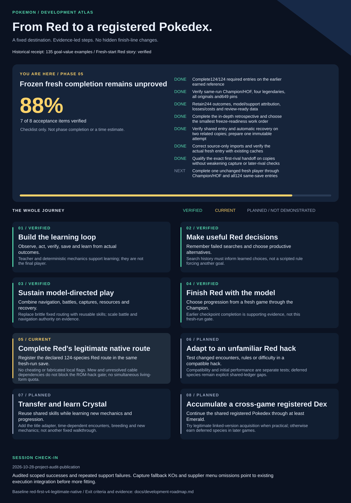

<!-- Generated by scripts/development_roadmap.py; edit the baseline/state, not this file. -->
# Development roadmap

Baseline: **red-first-v4-legitimate-native**. Reviewed through **2026-10-28-project-audit-publication**.

A learned player must complete a fresh-start, model-directed Red run and Red's declared 124-species legitimate native route before any ROM hack, then continue one shared registered Pokedex through later titles to at least Emerald.

## Current milestone

**Frozen fresh completion remains unproved: 7/8 acceptance items (88%).**
This is a checklist, not project completion or a remaining-time estimate.

- [x] Complete124/124 required entries on the earlier earned reference ([evidence](../docs/evidence/red-same-save-run-completion-2026-10-10.json))
- [x] Verify same-run Champion/HOF, four legendaries, all originals and649 pins ([evidence](../docs/evidence/red-same-save-run-completion-2026-10-10.json))
- [x] Retain244 outcomes, model/support attribution, losses/costs and review-ready data ([evidence](../docs/evidence/red-same-save-run-completion-2026-10-10.json))
- [x] Complete the in-depth retrospective and choose the smallest freeze-readiness work order ([evidence](../docs/evidence/red-completed-run-data-assessment-2026-10-11.json))
- [x] Verify shared entry and automatic recovery on two related copies; prepare one immutable attempt ([evidence](../docs/evidence/red-fresh-player-continuity-2026-10-11.json))
- [x] Correct source-only imports and verify the actual fresh entry with existing caches ([evidence](../docs/evidence/red-source-only-frozen-launch-2026-10-11.json))
- [x] Qualify the exact first-rival handoff on copies without weakening capture or later-rival checks ([evidence](../docs/evidence/red-early-route22-handoff-2026-10-11.json))
- [ ] Complete one unchanged fresh player through Champion/HOF and all124 same-save entries

Pinned historical learning receipt: **135 examples**. The current model and integration boundary are reported below in the latest review and active state; this older chart receipt is not full-game competence.

## Stable goals and exit criteria

### 01. Build the learning loop — verified

Observe, act, verify, save and learn from actual outcomes.

**Exit criterion:** Authenticated saved-state collection, retained-data fitting and a bounded post-fit continuation.

Teacher and deterministic mechanics support learning; they are not the final player.

[Current evidence](../docs/evidence/red-saved-endpoint-learning-result-2026-09-06.json)

### 02. Make useful Red decisions — verified

Remember failed searches and choose productive alternatives.

**Exit criterion:** A history-aware learner chooses between useful executable goals, learns from the result and continues productively.

Search history must inform learned choices, not a scripted rule forcing another goal.

[Current evidence](../docs/evidence/red-complete-evolution-learning-2026-09-07.json)

### 03. Sustain model-directed play — verified

Combine navigation, battles, captures, resources and recovery.

**Exit criterion:** Repeated multi-goal progress across varied Red situations, with measured costs, interventions and recovery.

Replace brittle fixed routing with reusable skills; scale battle and navigation authority on evidence.

[Current evidence](../docs/evidence/red-phase3-sustained-closeout-2026-09-08.json)

### 04. Finish Red with the model — verified

Choose progression from a fresh game through the Champion.

**Exit criterion:** One authenticated fresh start-to-finish model-directed Red run with concurrent Champion and Hall-of-Fame evidence; no fixed walkthrough or checkpoint stitching.

Earlier checkpoint completion is supporting evidence, not this fresh-run gate.

[Current evidence](../docs/evidence/red-two-hour-champion-recovery-2026-10-10.json)

### 05. Complete Red's legitimate native route — current

Register the declared 124-species Red route in the same fresh-run save.

**Exit criterion:** 124/124 selected-route registration in the authenticated model-directed run, with every unavailable version, cable-trade or event dependency recorded for later legitimate acquisition.

No cheating or fabricated local flags. Mew and unresolved cable dependencies do not block the ROM-hack gate; no simultaneous living-form quota.

[Current evidence](../docs/evidence/red-goal-aware-wild-training-2026-10-27.json)

### 06. Adapt to an unfamiliar Red hack — planned

Test changed encounters, rules or difficulty in a compatible hack.

**Exit criterion:** Only after the fresh Red story/124-route gate: compare initial performance and adaptation with a learner lacking Red experience.

Compatibility and initial performance are separate tests; deferred species remain explicit shared-ledger gaps.

### 07. Transfer and learn Crystal — planned

Reuse shared skills while learning new mechanics and progression.

**Exit criterion:** Measured transfer and adaptation, then model-led story and new registrations against the shared ledger.

Add the title adapter, time-dependent encounters, breeding and new mechanics; not another fixed walkthrough.

### 08. Accumulate a cross-game registered Dex — planned

Continue the shared registered Pokedex through at least Emerald.

**Exit criterion:** Per-title story completion and verified global species coverage with explicit version, trade, event and unsupported-mechanic gaps.

Try legitimate linked-version acquisition when practical; otherwise earn deferred species in later games.

## Latest review

Earlier reviews remain in the [status history](../configs/development-roadmap-state.json)
and dated work-session reports. Their next steps are not current instructions.

### 2026-10-28-project-audit-publication

Audited scoped successes and repeated support failures. Capture fallback KOs and supplier menu omissions point to existing execution integration before more fitting.

**Deviation:** No gameplay/model/stage/acceptance change. Source-only review snapshot has known quality debt; private originals remain unchanged.

**Next:** Keep runs paused for source publication. Next qualify suppliers and nonlethal capture support, then sustained play before more fitting or scale-up.

## Update contract

After a material learner milestone, strategy/requirements change or explicit request, update the [status record](../configs/development-roadmap-state.json), preserve the review history, and regenerate this page and graphic. Record changes to the stable goals in [roadmap decisions](roadmap-decisions.md).

The [North Star](../NORTH_STAR.md) and [active product state](../ACTIVE_PRODUCT_STATE.md) remain authoritative. The existing documentation check detects stale generated output; no new CI workflow is required.
